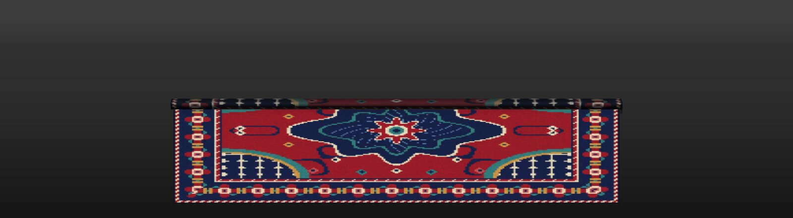
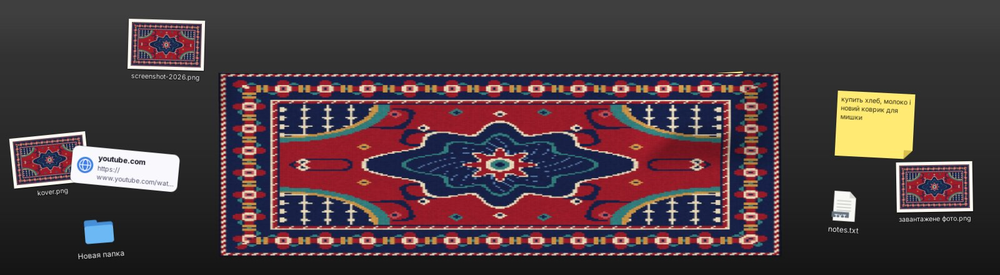
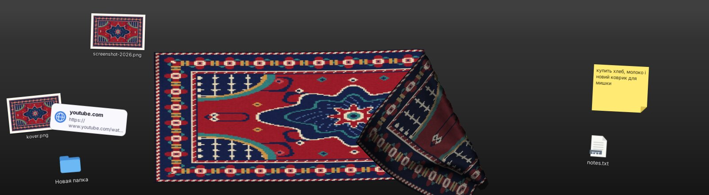

# Carpeted 🧶

Килим зі **справжньою фізикою тканини** для Hyprland (і будь-якого
wlroots-композитора). Натискаєш `SUPER+R` — знизу екрана розкручується рулон
килима, а поруч валяються речі, з якими ти недавно працював: файли, папки,
посилання, записки, картинки, скріншоти, завантаження і навіть вікна.
Кладеш їх де хочеш, загинаєш килим і ховаєш під нього. Як портфель, тільки
килим. 🤫





## Що вміє

- **Килим з фізикою**: тягни за будь-яке місце — він піднімається, загинається,
  показує виворіт, тримає складку. Подвійний клік по килиму — струсити рівно.
- **Ховати під килим**: загни кут, поклади карточку на відкриту підлогу,
  розгорни назад. Під килимом карточку не видно і не клікнути, але видно горбик.
- **Кидати на килим** (drag & drop з будь-якої програми):
  файли й папки, посилання з браузера, виділений текст, картинки.
- **Діставати назад**: перетягни карточку в Telegram, браузер, файловий
  менеджер, редактор — отримаєш файл / посилання / текст.
- **Вікна**: `SUPER+SHIFT+R` кидає активне вікно на килим (воно ховається, на
  килимі з'являється його мініатюра). Витягни карточку за межі килима або
  двічі клацни — вікно повернеться на поточний воркспейс.
- **Само з'являється**: нові файли в `~/Downloads` і нові скріншоти
  (`~/Pictures`, `~/Pictures/Screenshots`, `$XDG_SCREENSHOTS_DIR`, `$HYPRSHOT_DIR`).
- **Ctrl+V** — вставити з буфера обміну (файли, картинку чи текст) як карточку.
- Файли **не переносяться і не копіюються**: карточка — це лише посилання на
  файл. Прибрати карточку (ПКМ або Delete) не видаляє сам файл.

| Дія | Що робить |
| --- | --- |
| `SUPER+R` | розкрутити / згорнути килим |
| `SUPER+SHIFT+R` | закинути активне вікно на килим |
| ЛКМ по килиму і тягнути | підняти / загнути килим |
| подвійний клік по килиму | струсити рівно |
| тягнути карточку | перекласти або винести в іншу програму |
| подвійний клік по карточці | відкрити (файл, посилання), скопіювати (текст), повернути (вікно) |
| ПКМ / Delete | прибрати карточку з килима |
| Ctrl+V | вставити з буфера обміну |
| Esc | згорнути |

## Ресурси

Написано на C++ без GTK/Qt, напряму на Wayland + OpenGL ES.

- **Килим згорнутий**: працює лише демон, ~1 МБ власної пам'яті, 0% CPU,
  без жодного GPU-контексту. Прокидається тільки від команд і нових файлів.
- **Килим розгорнутий**: окремий процес з графікою. Кадри малюються, лише
  поки щось рухається (анімація, фізика, перетягування); у спокої — 0% CPU
  і GPU. Фізика ≈1.5 мс на крок.
- **Згорнув** — процес з графікою повністю завершується, і драйвер віддає
  всю відеопам'ять та RAM.

## Встановлення (Arch)

```sh
sudo pacman -S --needed base-devel meson ninja wayland wayland-protocols \
    mesa libxkbcommon cairo pango gdk-pixbuf2 grim
git clone -b claude/hyprland-physics-mat-od0f25 https://github.com/drartem34/carpeted
cd carpeted
meson setup build
ninja -C build
sudo ninja -C build install      # -> /usr/local/bin/carpeted
```

`grim` потрібен лише для мініатюр вікон.

Потім у `~/.config/hypr/hyprland.conf`
(готовий файл — [`contrib/hyprland.conf`](contrib/hyprland.conf)):

```ini
exec-once = carpeted
bind = SUPER, R, exec, carpeted toggle
bind = SUPER SHIFT, R, exec, carpeted stash-window
layerrule = noanim, carpeted   # необов'язково; якщо твоя версія Hyprland лається на цей рядок — видали
```

Налаштування — `~/.config/carpeted/config`, приклад:
[`contrib/config.example`](contrib/config.example).
Стан (карточки та їх положення) — `~/.local/state/carpeted/shelf.json`.

## Команди

```
carpeted                 запустити демон (килим згорнутий)
carpeted toggle          розкрутити / згорнути
carpeted show | hide
carpeted stash-window    активне вікно — на килим
carpeted shake           струсити килим рівно
carpeted quit
```

## Як це влаштовано

- `src/daemon.cpp` — завжди запущений демон без графіки: сокет команд,
  inotify на завантаження/скріншоти, ховання вікон через IPC-сокет Hyprland.
- `src/app.cpp` — процес килима: стан «розкручується / відкрито / згортається»,
  ввід, анімація рулону (спіраль Архімеда), фізика.
- `src/cloth.cpp` — тканина: сітка частинок, Verlet + обмеження відстаней
  (structural / shear / bending), тертя спокою, «самоколізія» перевернутої
  частини, горбики над предметами.
- `src/wayland.cpp` — layer-shell, вказівник, клавіатура (xkbcommon),
  drag & drop в обидва боки, буфер обміну, дробове масштабування, EGL.
- `src/renderer.cpp` — GLES 3: тінь, освітлення складок, виворіт, згладжені краї.
- `src/cards.cpp` — карточки (cairo + pango), мініатюри (gdk-pixbuf).

Тести: `meson test -C build`.

## Обмеження

- Килим можна загнути, але не скрутити руками в рулон (рулон — це анімація).
- Карточка вікна живе, поки живе вікно; мініатюра знімається в момент, коли
  вікно кидаєш на килим.
- Потрібен композитор з `wlr-layer-shell` (Hyprland, Sway, river, niri, …);
  ховання вікон — тільки Hyprland.
