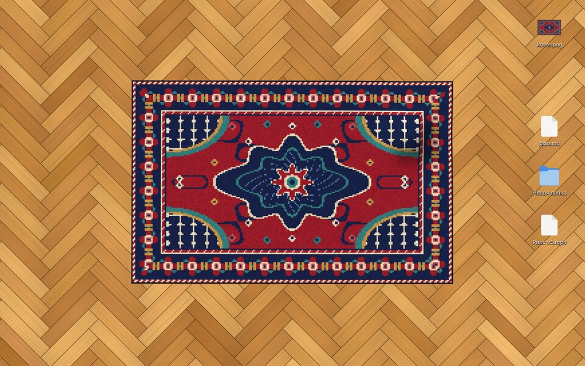

# Carpeted 🧶

Килим зі **справжньою фізикою тканини** прямо на робочому столі Linux
(Hyprland, Sway, river, niri… — будь-який Wayland-композитор з `wlr-layer-shell`).
Хапаєш за край — він загинається, показує виворіт і відкриває підлогу.
Закидаєш файли під нього — і накриваєш. Над схованими файлами видно горбик. 🤫




## Що вміє

- Тканина з частинок + PBD/Verlet-солвер (structural / shear / bending
  обмеження): килим загинається, падає, тримає складку, не розтягується.
- Виворіт килима — той самий візерунок, але тьмяніший (як у справжнього).
- Тіні від піднятих частин, перспектива, освітлення складок.
- Файли з `~/Desktop` (точніше `XDG_DESKTOP_DIR`) лежать на підлозі як іконки:
  тягай їх, подвійний клік — відкрити.
- Файли, накриті килимом, не клікаються і **не видно**. Щоб дістати — підніми килим.
- Перетягни файл з файлового менеджера на підлогу/килим — він скопіюється
  на Desktop саме в це місце (тобто можна кинути прямо під килим).
- Положення килима (разом зі складками!) і іконок зберігається між запусками.
- Коли нічого не рухається, програма спить і не їсть CPU.
- Килим і паркет «ялинка» генеруються процедурно, але можна підставити
  своє фото килима (`rug_image`) і свої шпалери (`floor`).

## Керування

| Дія | Що робить |
| --- | --- |
| Затиснути ЛКМ на килимі і тягнути | підняти/загнути килим за цю точку |
| Відпустити | килим падає як є (складка залишається) |
| Подвійний клік по килиму | «струсити» — килим падає рівно |
| Тягнути іконку | пересунути файл по підлозі |
| Подвійний клік по іконці | відкрити файл |
| Кинути файл з файлового менеджера | скопіювати на Desktop у точку падіння |

Як сховати файл: загни кут килима → перетягни іконку на відкриту підлогу →
розгорни килим назад.

## Встановлення

Потрібні: Python ≥ 3.11, GTK 4, PyGObject, pycairo, PyOpenGL, numpy і
[gtk4-layer-shell](https://github.com/wmww/gtk4-layer-shell).

**Arch / CachyOS / EndeavourOS**

```sh
sudo pacman -S gtk4 gtk4-layer-shell python-gobject python-cairo python-opengl python-numpy
```

**Fedora**

```sh
sudo dnf install gtk4 gtk4-layer-shell python3-gobject python3-cairo python3-pyopengl python3-numpy
```

**Debian 13 / Ubuntu 24.10+**

```sh
sudo apt install gir1.2-gtk-4.0 gir1.2-gtk4layershell-1.0 python3-gi python3-gi-cairo python3-opengl python3-numpy
```

Далі:

```sh
git clone https://github.com/drartem34/carpeted
cd carpeted
./install.sh          # кладе у ~/.local/share/carpeted і ~/.local/bin/carpeted
carpeted              # або без встановлення: python3 -m carpeted
```

## Hyprland

У `~/.config/hypr/hyprland.conf` (повний приклад — [`contrib/hyprland.conf`](contrib/hyprland.conf)):

```ini
exec-once = carpeted
bind = SUPER SHIFT, R, exec, carpeted --shake   # струсити килим
```

- Килим працює як шар `bottom` (під усіма вікнами, над шпалерами).
  `--layer background` — ще нижче, разом зі шпалерами.
- За замовчуванням малюється паркет і він **закриває шпалери**. Хочеш свої
  шпалери — `carpeted --floor none` (прозорий фон, лише килим + іконки) або
  `floor = "~/Pictures/wall.jpg"` у конфігу.
- Кілька моніторів: `carpeted --output DP-1`, `carpeted --output HDMI-A-1`
  (для кожного свій килим і свій стан). Команди до конкретного екземпляра теж
  з `--output`: `carpeted --output DP-1 --shake`.
- Layer-surface не отримує клавіатуру, тому команди — через `bind`:
  `carpeted --shake`, `carpeted --reset`, `carpeted --quit`.

### Куди ще можна запхати килим (ідеї)

1. **Схованка-скретчпад.** Килим у спеціальному воркспейсі, який викликається
   хоткеєм, а під ним лежить окрема тека — справжня «заначка»:
   ```ini
   exec-once = [workspace special:rug silent; float; size 80% 80%; center] carpeted --window --desktop-dir ~/Stash
   bind = SUPER, R, togglespecialworkspace, rug
   ```
2. **Звичайний робочий стіл** (`exec-once = carpeted`) — під килимом
   `~/Desktop`. Якщо на порожньому воркспейсі — це твій «підлоговий» стіл.
3. **Килим поверх своїх шпалер** — `--floor none`: шпалери лишаються,
   килим лежить на них і відкидає тінь.
4. **Килим-вхідна** — `--desktop-dir ~/Downloads`: усе скачане падає на
   підлогу, а непотріб замітається під килим 🙂

## Конфіг

`~/.config/carpeted/config.toml` (усі ключі необов'язкові):

```toml
layer = "bottom"            # "bottom" | "background"
output = "DP-1"             # монітор
floor = "parquet"           # "parquet" | "none" | шлях до картинки
rug_image = "~/Pictures/kover.png"   # своє фото килима (вид зверху, обрізане по краях)
rug_width = 760
rug_height = 480
rug_position = [300, 200]   # лівий верхній кут
rug_cell = 19               # крок сітки фізики в px (менше = детальніше, повільніше)
solver_iterations = 10      # жорсткість/точність
lift_height = 70            # наскільки високо піднімається схоплена точка
focal = 1800                # сила перспективи (менше = сильніше)
desktop_dir = "~/Desktop"
drop_action = "copy"        # що робити з кинутими файлами: "copy" | "move"
```

Стан (складки килима, позиції іконок) — у `~/.local/state/carpeted/`.

## Як це влаштовано

- `carpeted/cloth.py` — фізика. Сітка частинок, Verlet-інтеграція, обмеження
  відстаней розбиті на групи без спільних частинок, тож кожна група
  розв'язується векторно через numpy-слайси (Gauss–Seidel без Python-циклів).
  Підлога з тертям спокою, «самоколізія» дешевим трюком: перевернута частина
  лежить на товщину килима вище. Предмети під килимом піднімають «підлогу»
  під ним — так з'являються горбики.
- `carpeted/renderer.py` — OpenGL 3.3: паркет, іконки, тінь, килим з
  освітленням за нормалями, виворіт, згладжені краї.
- `carpeted/app.py` — GTK4 + gtk4-layer-shell, ввід, drag & drop, збереження.
- `carpeted/textures.py` — процедурний перський килим і паркет.

Розробка: `python3 -m pytest tests`, `python3 -m carpeted --window` — запуск
у звичайному вікні (працює і під X11).

## Обмеження

- Самоколізія спрощена: килим можна загнути один раз, але не скрутити в рулон.
- Іконки не можна витягнути з робочого столу в інші програми (поки).
